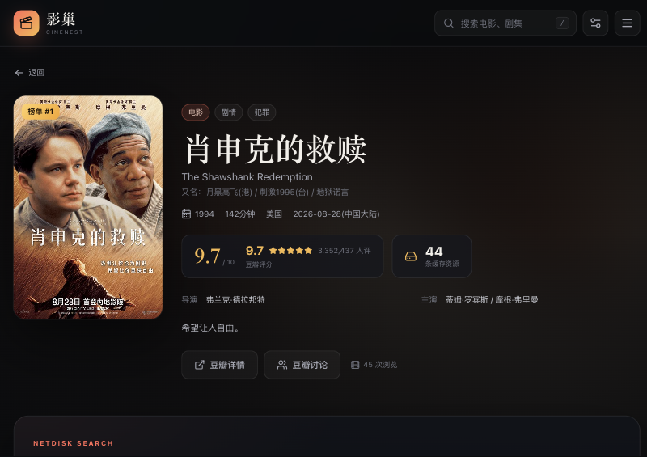
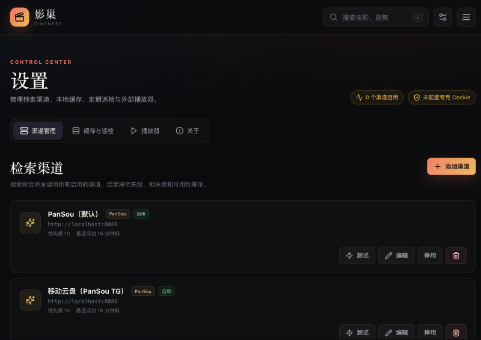

# 影巢 CineNest

> 豆瓣元数据 + 可插拔网盘检索 + 本地缓存 + 多端播放


## ✨ 核心功能

- **豆瓣同步**：正在热映、Top250、热门剧集、分类浏览
- **多渠道检索**：PanSou（默认）、竹云盘搜、L9、小云搜索、盘万搜、QuarkPanSo、Telegram / 腾讯 QQ 频道、自定义 HTTP API
- **夸克 / 移动云盘原生播放**：
  - 夸克：转存 → 多分片并发拉流 → 代理直链，**4K 原盘 20+ MB/s**
  - 移动云盘：HLS 代理重写 → 浏览器 / IINA / VLC 直接播
- **资源智能排序**：可用优先 → 匹配度 → 最近见过，前 5 条折叠展开
- **全平台外部播放器**：

| 平台 | 推荐 | 支持列表 |
|------|------|----------|
| macOS | IINA | IINA / VLC / MPV |
| Windows | PotPlayer | PotPlayer / VLC / MPV |
| iOS | Infuse | Infuse / VLC / nPlayer |
| Android | MX Player | MX Player / VLC / KMPlayer |

在「设置 → 播放器」或播放弹窗里选定默认播放器后，点击播放会先解析直链、再直接调起该播放器；
选择「浏览器」则留在页面内播放（播放弹窗里可随时改，改完立刻生效）。

- **代理可选**：代理开着优先走代理、关掉自动直连，播放流量始终直连优先
- **Cloudflare Tunnel**：零公网 IP、自动 HTTPS、可加 Access 认证

## 🚀 快速开始

```bash
git clone https://github.com/bigBoLang/yingchao.git
cd yingchao
cp .env.example .env   # 填 QUARK_COOKIE / APP_SECRET
npm install
npm run build
npm start              # http://localhost:8787
```

> 启动时会自动拉起本机 PanSou（默认 `localhost:8888`），退出时一起关闭。
> 如果 PanSou 不在默认位置，用 `PANSOU_BIN` 指定可执行文件路径；
> 想让影巢只连接已有的远程 PanSou，把 `PANSOU_BASE_URL` 改成远程地址即可。
>
> 公共搜索源（竹云盘搜、L9、小云搜索、盘万搜、QuarkPanSo）无需登录，但都有频控或
> 人机校验，结果可能时多时少；影巢会自动跳过暂时不可用的渠道，不影响其它来源。
> Telegram 频道需要 PanSou 能访问 `t.me`（通常要开代理）；腾讯 QQ 频道需要
> PanSou 启用 `qqpd` 插件，并在 `http://localhost:8888/qqpd/<hash>` 扫码登录、配置频道。

### 局域网 / 公网访问

```bash
# 开发模式
HOST=0.0.0.0 npm run dev

# 生产 + Cloudflare Tunnel（临时域名）
cloudflared tunnel --url http://localhost:8787
# → https://xxx.trycloudflare.com

# 固定域名：把域名 NS 改到 Cloudflare，建 Named Tunnel + DNS 路由
```

> **播放速度提醒**：所有视频字节都会经过访问它的那个域名。走 Cloudflare
> 隧道时，即使人在家里，流量也会绕到 Cloudflare 再回来（实测约 0.1 MB/s，
> 局域网直连约 6 MB/s）。
>
> 影巢会自动识别「客户端与服务器同一家庭网络」：从公网域名打开页面时，
> 自动 302 到 `http://<局域网IP>:8787`，之后播放完全不经过 Cloudflare。
> 临时想留在域名上，访问 `https://域名/?lan=0` 即可（记一年）；
> 访问 `https://域名/?lan=1` 可恢复自动跳转。
> 远程访问（手机流量、公司网络）仍会走隧道，速度受家庭上传带宽限制。

## 📸 界面预览

| 首页 | 详情页资源列表 |
|------|----------------|
|  |  |

| 播放弹窗（外部播放器） | 设置-播放器 |
|------------------------|-------------|
|  |  |

| 设置-渠道管理 | 移动端播放器 |
|---------------|--------------|
|  |  |

## 🎬 4K 原盘播放演示

> 夸克分享 60GB MKV → 转存 → 4 路并发拉流 → **IINA / VLC 硬解 4K HDR**


## ⚙️ 配置说明

| 环境变量 | 说明 |
|----------|------|
| `QUARK_COOKIE` | 夸克登录 Cookie（设置页也可填） |
| `APP_SECRET` | 播放链接签名密钥，**生产环境必改** |
| `HTTPS_PROXY` | 可选出站代理；代理在线时优先使用，离线时自动直连 |
| `PLAY_PROXY_MODE` | `tunnel`（跟随访问域名，默认）/ `direct`（配合 `PUBLIC_IP` 直连） |
| `PANSOU_AUTOSTART` | 启动时自动拉起本机 PanSou（默认 `true`） |
| `PANSOU_BIN` | PanSou 可执行文件路径，不填则自动查找 |
| `ENABLE_ZHUYUN` | 是否在首次启动时创建竹云盘搜渠道（默认 `true`） |
| `ZHUYUN_BASE_URL` / `L9_BASE_URL` / `YUNSO_BASE_URL` / `PANWS_BASE_URL` / `QUARKPANSO_BASE_URL` | 对应公共搜索源地址 |
| `ENABLE_L9` / `ENABLE_YUNSO` / `ENABLE_PANWS` / `ENABLE_QUARKPANSO` | 是否自动创建对应公共渠道（默认 `true`） |
| `AUTO_LAN_REDIRECT` | 同一家庭网络从公网域名访问时，自动跳到局域网直连（默认 `true`） |
| `LAN_IP` | 多网卡时手动指定局域网地址（如 `192.168.1.10`） |
| `HOST=0.0.0.0` | 局域网访问 |
| `PORT=8787` | 服务端口 |
| `AUTH_USER` / `AUTH_PASS` | 可选访问密码，两者都填即启用 HTTP Basic 登录 |
| `ALLOW_PRIVATE_HOSTS` | 允许自定义渠道/视频直链访问内网地址（默认 `false`） |
| `HISTORY_REFRESH_HOURS` | 播放记录相关作品的资源刷新与优先巡检间隔（默认 6 小时） |
| `QUARK_SPACE_THRESHOLD` | 网盘占用超过该比例时，转存前清理播放缓存目录（默认 0.7） |

## 🔐 安全提醒

- Cookie 仅存在本机 SQLite，**绝不上传**
- 服务默认无鉴权，**仅在可信网络**或配合 Cloudflare Access 使用；暴露到公网前请配置 `AUTH_USER` / `AUTH_PASS`
- 多地同时播放大文件易触发夸克风控，建议配合 Access 限制访问

## 📄 License

MIT